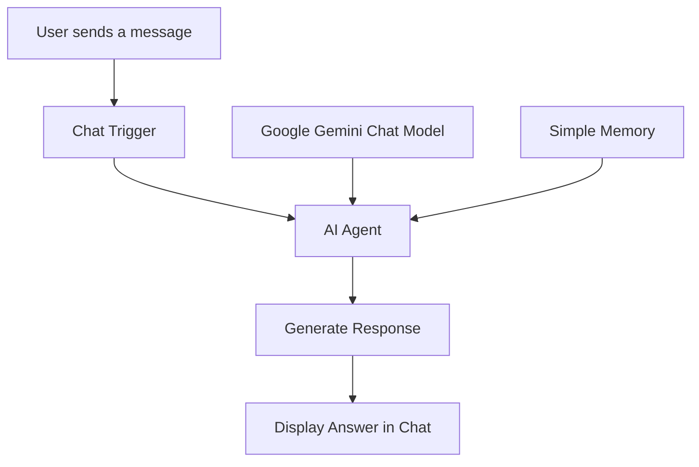

# Event Assistant Bot

🎥 **[Watch Project Demo – Loom](https://www.loom.com/share/730c160b873146beb555e9e124d93fdd)**

An AI-powered Event Assistant Bot built using **n8n and Google Gemini**. It helps event attendees quickly find information about event schedules, speakers, sessions, dates, and venue details through a public web-based chat interface.

## 1. Project Overview

The Event Assistant Bot is designed to answer attendees' questions about an event through a conversational chatbot.

Instead of searching through lengthy event information, attendees can simply ask questions and receive clear, concise responses.

**Sample Event:** Tech Innovation Summit 2026

## 2. Target Audience

- Event attendees
- Students and participants
- Event organizers
- People looking for event schedules and speaker information

## 3. Features

- **Agenda Lookup:** Provides the complete event schedule and session timings.
- **Speaker Information:** Answers questions about speakers and their topics.
- **Venue Details:** Provides event date, time, and location.
- **Session Timing:** Answers questions about specific sessions.
- **Conversation Memory:** Maintains conversational context using Simple Memory.
- **Unknown Information Handling:** Avoids inventing answers when information is unavailable.
- **Input Handling:** Politely asks users to clarify unclear messages.
- **Unrelated Question Handling:** Restricts responses to event-related topics.
- **Retry Configuration:** Configured AI Agent retry settings for temporary failures.

## 4. Technology Stack

| Technology | Purpose |
|---|---|
| n8n | Workflow automation |
| Google Gemini | AI-powered responses |
| AI Agent | Processes user questions |
| Simple Memory | Maintains conversation context |
| Chat Trigger | Receives chat messages |

## 5. Workflow Architecture

The chatbot follows this workflow:

## 6. Project Workflow

1. The attendee opens the public chatbot.
2. The attendee asks an event-related question.
3. The Chat Trigger receives the message.
4. The AI Agent processes the question using Google Gemini.
5. Simple Memory provides conversational context.
6. The chatbot generates and displays a response.

## 7. Setup Instructions

### Requirements
- An n8n account or n8n Community Edition instance.
- A Google Gemini API key.
- Internet connection.

### Installation and Configuration

1. Download the workflow JSON file from this repository.
2. Open your n8n instance.
3. Import the workflow JSON file.
4. Open the Google Gemini Chat Model node.
5. Create or select your Google Gemini API credential.
6. Save the credential and connect it to the model node.
7. Check the AI Agent and Simple Memory connections.
8. Publish the workflow.
9. Enable public chat access through the Chat Trigger.
10. Open the generated Chat URL to interact with the chatbot.

**Note:** API credentials must be configured securely inside n8n. Never upload actual API keys or passwords to GitHub.

## 8. Testing

The chatbot was tested with the following scenarios:

| Test Case | Result |
|---|---|
| Event agenda lookup | Passed |
| Speaker information | Passed |
| Venue and event timing | Passed |
| Specific session timing | Passed |
| Unknown information handling | Passed |
| Follow-up questions | Passed |
| Unclear input handling | Passed |
| Unrelated question handling | Passed |
| Gemini API failure handling | Not yet tested |
| Workflow execution error handling | Not yet tested |
| Actual retry behavior | Configured, not yet tested |

## 9. Workflow Export

The n8n workflow JSON template is included in this repository:

`Event_Assistant_Bot_GitHub_Final.json`

Import it into n8n and configure your own Gemini credentials before running it.

## 10. Future Improvements

- Automatic event reminders and notifications.
- WhatsApp or Telegram integration.
- Voice-based interaction.
- Automatic attendee follow-ups.
- Additional event information and FAQs.

## 11. Project Information

**Project:** Event Assistant Bot  
**Organization:** Think AI Works  
**Project Number:** 03  
**Developer:** Kinza

## 12. Project Screenshots

### Event Agenda

### Speaker Information

### n8n Workflow Architecture

---
Project status: Developed and tested.
